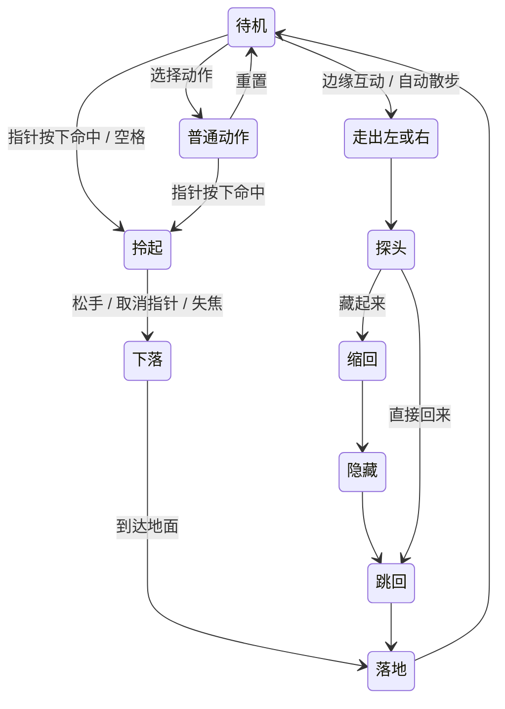

# 元数据与动作衔接

## 图集

`src` 相对于 `assets/manifest.json`。图集按行优先排列；第 i 帧左上角为 `(i % cols * tileW, floor(i / cols) * tileH)`。不要扫描透明内容来重新决定每帧的摆放位置。

`anchor` 是瓦片内的参考点；`displayScale` 是相对参考画布的整体比例。渲染顺序为：平移到角色位置 → 旋转 → 缩放 → 按负 anchor 绘制瓦片。拎腰的参考点位于腰部，比例 1.28；落地时切回普通脚底锚点。

`bounds` 是每帧可见像素范围，用于命中测试，不是渲染裁剪框。`loop: [first,last]` 包含首尾两帧；前导帧播放一次，然后在指定区间重复。`loop:null` 表示单次动作。循环区间是策划参数，不保证图像首尾完全一致。

24 fps 的整毫秒帧长应通过 `round((i+1)*1000/24)-round(i*1000/24)` 得到，而非每帧固定 42ms。浏览器示例按时间算帧，刷新率不必等于素材帧率。

## 墙边场景

`kind:scene` 的瓦片是整张 240×320 参考画面，含固定遮挡配准，不使用普通角色脚底 anchor。左侧 offset=-34、右侧 offset=+34；配合画布物理裁切，让角色更靠屏边。换宽高比时应重新设计场景映射，不要只把图片拉伸。

出场用 `emerge_wall_left/right` 正向播放，从画外到扒边；退出用独立 `retreat_wall_left/right` 正向播放，不能简单倒放出场。缩回最后一帧为空。不得追加停用的 bottom 路线。

## 示例状态图

普通动作查看器结束后停在尾帧，方便逐帧检查；互动演示的落地结束后回待机。`walk-out`、`fall`、`jump-in` 使用已有动画搭配连续位移；演示不把这些组合计作额外生成素材。坐下片段可单独播放，板凳的形状、座面与角色配准应由宿主场景决定。

## 资源预算

WebP 是存储格式，解码为 RGBA 后会占用更多内存：一个 1920×5120 墙边图集约 37.5 MiB。网页采用按需加载、最多缓存六张图集；不要同时解码全部 31 张。原生桌宠可按帧解码或采用自己的 GPU 纹理管理策略。小屏幕建议使用紧凑包或按目标尺寸重新打包。
